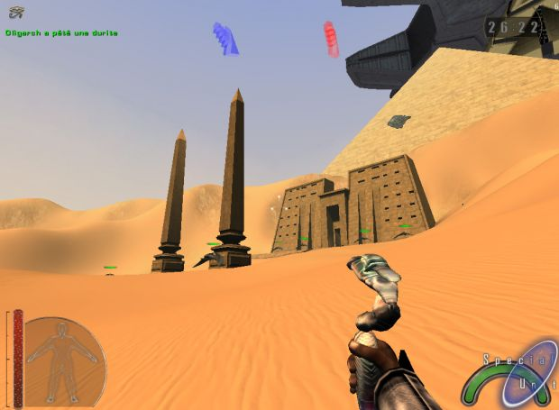
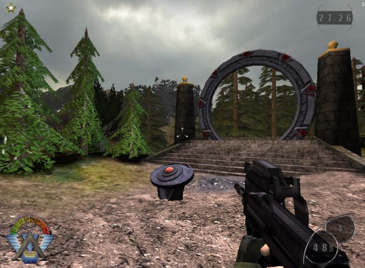
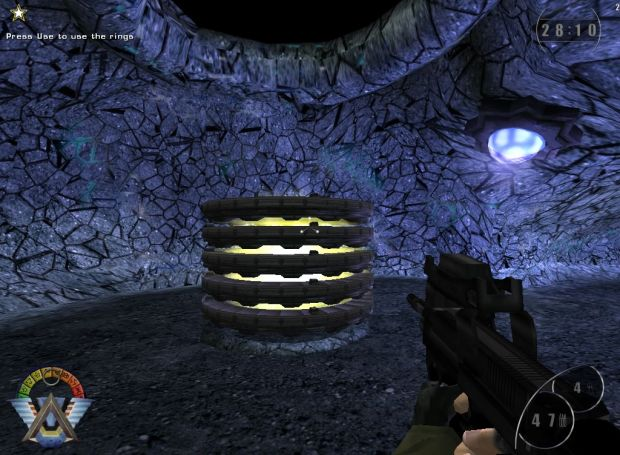
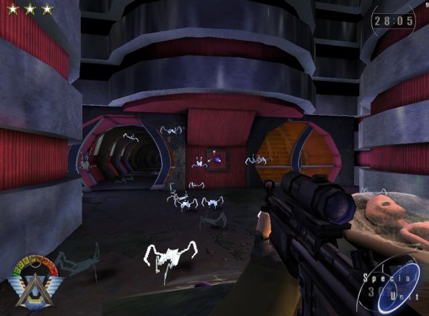

# Special Unit: Redial

 **[English](#english)** &nbsp;·&nbsp;  **[Français](#francais)**

 Bots that play the objectives, and fixes, for Special Unit, the Stargate mod for Unreal Tournament 2004. Part of **[Stargate Redial](https://github.com/Stargate-Redial)**.

 Des bots qui jouent les objectifs, et des correctifs, pour Special Unit, le mod Stargate d'Unreal Tournament 2004. Fait partie de **[Stargate Redial](https://github.com/Stargate-Redial)**.

| | |
|---|---|
|  |  |
|  |  |

**Discord:** [discord.com/invite/SgHPP4mZyB](https://discord.com/invite/SgHPP4mZyB) &nbsp;·&nbsp; **24/7 server:** `open 92.222.243.147:7810`

---

##  English

An unofficial add-on for **Special Unit** (2013), the Stargate SG-1 total conversion for Unreal Tournament 2004 by the SU Team:

- **It adds bots that play every map:** they attack and defend the objectives, dial and defend the stargate, carry the crystals, ride the rings and the Hummers, fly the fighters and the capital ships, and fight the Replicators in co-op.
- **It runs the mod on today's UT2004** with the [OldUnreal 3374 patch](https://github.com/OldUnreal/UT2004Patches/releases), and lists the online servers again.
- **It fixes bugs of the mod that players meet too:** every round lasted 20 minutes whatever the map, every crystal scored for the Goa'uld, and the team that brought the last crystal won the round.
- **Faster movement** (x1.4, "SU Speed"): the soldiers walked at 250 where UT2004 runs at 440.

*Made with love by [@CreepyInpu](https://x.com/CreepyInpu).*

### Quick start

1. Get **Unreal Tournament 2004**. It is no longer sold on Steam, but [OldUnreal](https://www.oldunreal.com/downloads/ut2004/full-game-installers/), who maintain the game's community patches, offer a free installer for the full game: download **`UT2004.exe`** (Windows 7 or later) and run it. It installs the game in the folder you choose, already patched. A Steam or retail copy works too.
2. Download **`specialunit-redial-v1.0.2.zip`** from [Releases](../../releases), extract it anywhere and double-click **`install.bat`**.
3. The installer finds UT2004, offers the OldUnreal 3374 patch if it's missing, then opens the [ModDB page](https://www.moddb.com/mods/special-unit/downloads) of Special Unit: download **`SpecialUnit.zip`** (250 MB). The installer picks it up in your Downloads folder by itself.
4. Launch **Stargate - Special Unit** from the Desktop. Then either:
   - **Instant Action** on an `SU-` map, with as many bots as you like. In **Mutators**, check that "SU Bot Fix" and "SU Speed" are ticked: the installer ticks them, unless you had already picked mutators in the mod;
   - or join the 24/7 server: **Join Game > Favorites**, or `open 92.222.243.147:7810` in the console.

### Installation details

- **The installer** checks the SHA-256 of `SpecialUnit.zip` and installs the mod into `UT2004\SpecialUnit`, then the Redial files. You can run it again safely. Options:
  - `install.bat -UT2004Dir "D:\Games\UT2004"` if UT2004 isn't found;
  - `install.bat -ZipPath "D:\Downloads\SpecialUnit.zip"` if the zip is elsewhere.
- **The mod itself is not in this project:** its licence forbids redistributing it. You download it from ModDB.
- **To uninstall,** run **`uninstall.bat`** (it removes `UT2004\SpecialUnit` and the shortcuts).
- **What the installer changes,** and how to do it by hand: [docs/DETAILS.md](docs/DETAILS.md).

### Play online

A server runs 24/7 with 8 bots, so there's always a match: `open 92.222.243.147:7810`, or find it under **Internet > Special Unit**. Bots leave as players join. Come and say hello on the [Discord](https://discord.com/invite/SgHPP4mZyB).

To host your own: [docs/LINUX_SERVER.md](docs/LINUX_SERVER.md).

### The bots

Special Unit came with bots, but they stood at their spawn on most maps. Redial is a server-side mutator, **SU Bot Fix** (`SUBotFix`): it repairs the paths the bots need when the map loads, and steers them where the mod's own AI gives up. Players don't download it.

- **Navigation:** the maps were built for smaller characters than the mod's soldiers, so bots couldn't use most paths. Paths are resized, broken networks joined, and corridors laid by the bots' own flood fill where a map has no path at all (TokRa's crystal tunnels, IceDet's caves and plank bridge).
- **Objectives:** bots go for the objectives the mod never pointed them to, use the rings, fetch and carry the crystals, step on the triggers that bring the bridges, and defend what their team holds.
- **Fights:** bots fire while they move, medics heal with their syringe, soldiers refill at the ammo crates, Goa'uld bots get a staff weapon (the zat can't hurt an objective), gunners stop firing into their own ship, and pilots make attack passes and pull out before they hit their target or the ground.
- **Balance:** each map keeps a score of its last rounds, and the side that wins more gets weaker bots, round after round. While you play, the gap between the two sides stays within one skill level, so neither your teammates nor your enemies are useless.
- **Things a player should not see:** a bot is never moved under a player's eyes, and while you play, a bot that respawns far from the fight takes as long to come back as you would (on Abydos, the Hummer drive across the desert).

| Console command / setting | Effect |
|---|---|
| Instant Action > Bots | number of bots |
| Instant Action > Bot Skill, or `GameDifficulty` in `SpecialUnit.ini` | bot skill (0 to 7); the 24/7 server uses 4 |
| `[SUBotFix.MutSUBotFix] bAutoBalance=False` | turns the skill balance off |
| `[SUTweaks.MutSUSpeed] SpeedScale=1.4` | movement speed (1.0 = the mod's own) |

### Maps

Rounds between bots only, at skill 3 and with the maps' own round time:

| Map | Bots |
|---|---|
| SU-Abydos | The wall, the temple, the DHD, then the race for the crystal. Balanced. |
| SU-P3X-548 | The Tau'ri take the fort, three triggers and the DHD; the Goa'uld can blow up the ammo barrel. Balanced (with a wide skill gap between the sides). |
| SU-Chulak | The Goa'uld computer, then the generator. Balanced, all or nothing: the Tau'ri break in early or the computer holds to the end. |
| SU-TokRa | Big fights, then the race for 9 crystals in the tunnels. Balanced. |
| SU-IceDet | All 5 stages, down to the last crystal over the light bridge and the plank bridge. The Tau'ri usually win it, in 10 to 25 of its 30 minutes. |
| SU-Antartica | Fleet battle: capital ships against each other, fighters in close. The Goa'uld win it more often since 1.0.2: their gliders no longer crash into the Teltac, and the Tau'ri bots don't guard it well yet. |
| SU-Asteroid | Fighter battles, but bots can't hit the extractors: the Goa'uld win at the 10-minute limit without a Tau'ri player. |
| SU-Asgard[Medium], SU-Asgard[Hard], SU-X303Down | Co-op against the Replicators. Bots fight and get 4 to 6 of Asgard[Medium]'s 7 objectives, then run out of lives: it takes players to win. |

### If something goes wrong

- **The server list is empty:** the OldUnreal 3374 patch is missing. Run `install.bat` again and accept it.
- **The installer can't find UT2004 or the zip:** pick the UT2004 folder in the window it opens (the one holding `System\UT2004.exe`), or pass `-UT2004Dir` or `-ZipPath` (see above).
- **"Version mismatch" when joining a server:** your `SpecialUnit\System\SpecialUnit.u` isn't the ModDB release. Reinstall the mod.

---

##  Français

Un ajout non officiel pour **Special Unit** (2013), la conversion totale Stargate SG-1 d'Unreal Tournament 2004 par la SU Team :

- **il ajoute des bots qui jouent toutes les cartes :** ils attaquent et défendent les objectifs, composent et défendent la porte des étoiles, portent les cristaux, prennent les anneaux et les Hummers, pilotent les chasseurs et les vaisseaux, et combattent les Réplicateurs en coopération ;
- **il fait tourner le mod sur l'UT2004 d'aujourd'hui** avec le [patch OldUnreal 3374](https://github.com/OldUnreal/UT2004Patches/releases), et la liste des serveurs en ligne s'affiche de nouveau ;
- **il corrige des bugs du mod que les joueurs subissent aussi :** chaque manche durait 20 minutes quelle que soit la carte, chaque cristal comptait pour les Goa'uld, et l'équipe qui rapportait le dernier cristal gagnait la manche ;
- **des déplacements plus rapides** (x1,4, « SU Speed ») : les soldats marchaient à 250, quand UT2004 court à 440.

*Fait avec amour par [@CreepyInpu](https://x.com/CreepyInpu).*

### Démarrage rapide

1. Procurez-vous **Unreal Tournament 2004**. Il n'est plus vendu sur Steam, mais [OldUnreal](https://www.oldunreal.com/downloads/ut2004/full-game-installers/), qui maintient les patchs communautaires du jeu, propose un installeur gratuit du jeu complet : téléchargez **`UT2004.exe`** (Windows 7 ou plus récent) et lancez-le. Il installe le jeu dans le dossier de votre choix, déjà patché. Une copie Steam ou en boîte fonctionne aussi.
2. Téléchargez **`specialunit-redial-v1.0.2.zip`** dans les [Releases](../../releases), extrayez-le n'importe où, puis double-cliquez sur **`install.bat`**.
3. L'installeur trouve UT2004, propose le patch OldUnreal 3374 s'il manque, puis ouvre la [page ModDB](https://www.moddb.com/mods/special-unit/downloads) de Special Unit : téléchargez **`SpecialUnit.zip`** (250 Mo). L'installeur le trouve tout seul dans votre dossier Téléchargements.
4. Lancez **Stargate - Special Unit** depuis le Bureau. Ensuite :
   - **Partie instantanée** sur une carte `SU-`, avec autant de bots que vous voulez. Dans **Mutators**, vérifiez que « SU Bot Fix » et « SU Speed » sont cochés : l'installeur les coche, sauf si vous aviez déjà choisi des mutators dans le mod ;
   - ou rejoignez le serveur 24/7 : **Rejoindre une partie > Favoris**, ou `open 92.222.243.147:7810` dans la console.

### Détails d'installation

- **L'installeur** vérifie l'empreinte SHA-256 de `SpecialUnit.zip` et installe le mod dans `UT2004\SpecialUnit`, puis les fichiers de Redial. On peut le relancer sans risque. Options :
  - `install.bat -UT2004Dir "D:\Jeux\UT2004"` si UT2004 n'est pas trouvé ;
  - `install.bat -ZipPath "D:\Téléchargements\SpecialUnit.zip"` si le zip est ailleurs.
- **Le mod lui-même n'est pas dans ce projet :** sa licence interdit de le redistribuer. Vous le téléchargez sur ModDB.
- **Pour désinstaller,** lancez **`uninstall.bat`** (il supprime `UT2004\SpecialUnit` et les raccourcis).
- **Ce que l'installeur modifie,** et comment le faire à la main : [docs/DETAILS.md](docs/DETAILS.md) (en anglais).

### Jouer en ligne

Un serveur tourne 24h/24 avec 8 bots, donc il y a toujours une partie : `open 92.222.243.147:7810`, ou dans **Internet > Special Unit**. Les bots cèdent leur place aux joueurs. Venez dire bonjour sur le [Discord](https://discord.com/invite/SgHPP4mZyB).

Pour héberger le vôtre : [docs/LINUX_SERVER.md](docs/LINUX_SERVER.md) (en anglais).

### Les bots

Special Unit avait des bots, mais ils restaient à leur point d'apparition sur la plupart des cartes. Redial est un mutator côté serveur, **SU Bot Fix** (`SUBotFix`) : il répare au chargement de la carte les chemins dont les bots ont besoin, et les guide là où l'IA du mod abandonne. Les joueurs n'ont rien à télécharger.

- **Navigation :** les cartes ont été construites pour des personnages plus petits que les soldats du mod, et les bots ne pouvaient pas emprunter la plupart des chemins. Les chemins sont redimensionnés, les réseaux coupés sont reliés, et des couloirs sont tracés par remplissage là où une carte n'a aucun chemin (les tunnels à cristaux de TokRa, les grottes et le pont de planches d'IceDet).
- **Objectifs :** les bots vont vers les objectifs que le mod ne leur indiquait pas, prennent les anneaux, vont chercher et portent les cristaux, marchent sur les déclencheurs qui font venir les ponts, et défendent ce que leur équipe tient.
- **Combats :** les bots tirent en se déplaçant, les médecins soignent avec leur seringue, les soldats se ravitaillent aux caisses de munitions, les bots goa'uld reçoivent une lance (le zat ne peut pas abîmer un objectif), les artilleurs ne tirent plus dans leur propre vaisseau, et les pilotes font des passes d'attaque et dégagent avant de percuter leur cible ou le sol.
- **Équilibre :** chaque carte garde un score de ses dernières manches, et le camp qui gagne le plus reçoit des bots plus faibles, manche après manche. Quand vous jouez, l'écart entre les deux camps reste dans un niveau, pour que ni vos coéquipiers ni vos adversaires ne soient inutiles.
- **Ce qu'un joueur ne doit pas voir :** un bot n'est jamais déplacé sous les yeux d'un joueur et, quand vous jouez, un bot qui réapparaît loin du combat met autant de temps que vous à revenir (sur Abydos, la traversée du désert en Hummer).

| Commande console / réglage | Effet |
|---|---|
| Partie instantanée > Bots | nombre de bots |
| Partie instantanée > niveau des bots, ou `GameDifficulty` dans `SpecialUnit.ini` | niveau des bots (0 à 7) ; le serveur 24/7 utilise 4 |
| `[SUBotFix.MutSUBotFix] bAutoBalance=False` | désactive l'équilibrage des niveaux |
| `[SUTweaks.MutSUSpeed] SpeedScale=1.4` | vitesse de déplacement (1.0 = celle du mod) |

### Cartes

Manches entre bots uniquement, au niveau 3 et avec la durée de manche prévue par chaque carte :

| Carte | Bots |
|---|---|
| SU-Abydos | Le mur, le temple, le DHD, puis la course au cristal. Équilibrée. |
| SU-P3X-548 | Les Tau'ri prennent le fort, trois déclencheurs et le DHD ; les Goa'uld peuvent faire sauter le baril de munitions. Équilibrée (avec un grand écart de niveau entre les camps). |
| SU-Chulak | L'ordinateur goa'uld, puis le générateur. Équilibrée, tout ou rien : les Tau'ri percent tôt, ou l'ordinateur tient jusqu'au bout. |
| SU-TokRa | De gros combats, puis la course aux 9 cristaux dans les tunnels. Équilibrée. |
| SU-IceDet | Les 5 étapes, jusqu'au dernier cristal par le pont de lumière et le pont de planches. Les Tau'ri la gagnent le plus souvent, en 10 à 25 de ses 30 minutes. |
| SU-Antartica | Bataille de flottes : les vaisseaux s'affrontent, les chasseurs viennent au contact. Les Goa'uld la gagnent plus souvent depuis la 1.0.2 : leurs planeurs ne s'écrasent plus sur le Teltac, et les bots tau'ri ne le gardent pas encore bien. |
| SU-Asteroid | Combats de chasseurs, mais les bots ne touchent pas les extracteurs : sans joueur tau'ri, les Goa'uld gagnent à la limite des 10 minutes. |
| SU-Asgard[Medium], SU-Asgard[Hard], SU-X303Down | Coopération contre les Réplicateurs. Les bots combattent et remplissent 4 à 6 des 7 objectifs d'Asgard[Medium], puis épuisent leurs vies : il faut des joueurs pour gagner. |

### En cas de problème

- **La liste des serveurs est vide :** il manque le patch OldUnreal 3374. Relancez `install.bat` et acceptez-le.
- **L'installeur ne trouve pas UT2004 ou le zip :** choisissez le dossier d'UT2004 dans la fenêtre qu'il ouvre (celui qui contient `System\UT2004.exe`), ou passez `-UT2004Dir` ou `-ZipPath` (voir plus haut).
- **« Version mismatch » en rejoignant un serveur :** votre `SpecialUnit\System\SpecialUnit.u` n'est pas celui de ModDB. Réinstallez le mod.

---

## Stargate Redial

Stargate mods brought back to life, with bots and a server running 24/7 · Les mods Stargate qui reprennent vie, avec des bots et un serveur 24h/24:

- [StargateTC: Redial](https://github.com/Stargate-Redial/stargatetc-redial) · Half-Life
- [StargateTC 2: Redial](https://github.com/Stargate-Redial/stargatetc2-redial) · Source SDK Base 2006
- [Stargate TLS: Redial](https://github.com/Stargate-Redial/stargatetls-redial) · Source SDK Base 2007
- **Special Unit: Redial** · Unreal Tournament 2004

*A fan project, not affiliated with the SU Team, Epic Games or MGM. Special Unit (c) the SU Team. Screenshots from the mod's [ModDB page](https://www.moddb.com/mods/special-unit). Stargate SG-1 is a trademark of MGM.*
